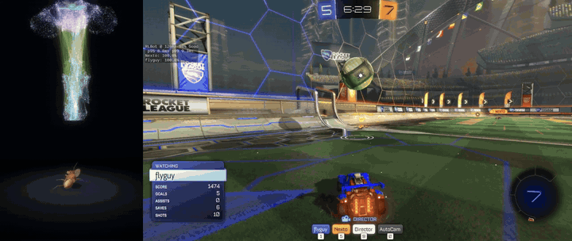
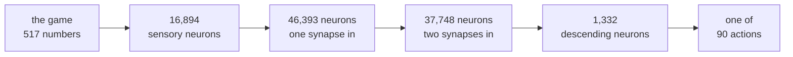
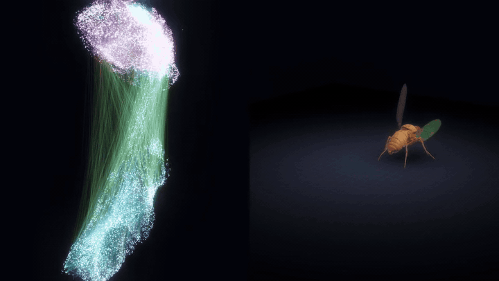

<h1 align="center">🪰 flyguy</h1>

<p align="center"><b>A Rocket League bot whose network is wired like a fruit fly's nervous system.</b></p>

<p align="center">
  
  
  
  
  
  <a href="https://ballchasing.com/replay/97a8cb48-3c3a-4e56-8753-494c1f710cc7"></a>
</p>

<p align="center">
  <a href="https://www.youtube.com/watch?v=e3WVd6I4pOU">
    
  </a>
</p>

<p align="center"><i>flyguy (blue) scores on Nexto. Left: every neuron of its network firing as it decides, and a
simulated fly body moved by the same signals.<br>
<a href="https://www.youtube.com/watch?v=e3WVd6I4pOU">▶ Watch a whole match on YouTube</a> (a later flyguy than the
copy published here).</i></p>

<p align="center"><b>42 to 14 against the real Nexto.</b> The last flyguy reached 42 goals before Nexto reached 28,
which the RLBot community calls nullifying Nexto: <a href="https://ballchasing.com/replay/97a8cb48-3c3a-4e56-8753-494c1f710cc7">the replay</a>.</p>

<p align="center">
  <a href="docs/GETTING_STARTED.md">Getting started</a> ·
  <a href="#watch-it-think">Watch it think</a> ·
  <a href="docs/HOW_IT_WORKS.md">How it works</a> ·
  <a href="docs/HOW_IT_WAS_MADE.md">How it was made</a> ·
  <a href="CREDITS.md">Credits</a>
</p>

---

## What is this?

Most Rocket League bots are a stack of dense layers. flyguy's network is the wiring diagram of an animal: the
[male fruit fly central nervous system connectome](https://male-cns.janelia.org/) from the Janelia FlyEM project,
the brain and the nerve cord, neuron by neuron.

- **One unit per neuron, one trainable strength per connection.** Nothing else sits between them.
- **The game goes in at the fly's sensory neurons.** Each one listens to a handful of numbers about the car, the ball
  and the other cars.
- **Three synapses later the answer comes out of its descending neurons**, the cells that in a real fly carry the
  brain's commands down to the body. One of 90 actions is read off them, 15 times a second.



| | |
|---|---|
| Neurons in the wiring diagram | **166,700** |
| Connections between them (2 or more synapses) | **15,283,167** |
| Used in a decision (three synapses from senses to descending neurons) | **70,636 neurons, 2,992,734 connections** |
| Learned numbers that are not fly (the plugs in and out) | 407,168 |
| Time for a decision | about 2.5 ms on one CPU core |

**What it is not:** a simulated fly. The units are ordinary artificial ones, the strengths were found by gradient
descent, and the fly's senses are fed game numbers they never evolved for. It is a network with a fly's wiring,
taught to play by another bot. Whether the fly's particular wiring helps, compared with any other sparse graph of the
same size, was not tested. More in [How it works](docs/HOW_IT_WORKS.md).

## How good is it?

flyguy was taught by Whiskers, a self-play bot by the same authors, and then left to train by reinforcement
learning.

**In the real game** the last version, after 569 million moments of reinforcement learning, beat the real
[Nexto](https://github.com/Rolv-Arild/Necto) 42 to 14 in one long 1v1 match ([replay](https://ballchasing.com/replay/97a8cb48-3c3a-4e56-8753-494c1f710cc7)). Reaching 42 goals
before Nexto reaches 28 is the mark the RLBot community calls nullifying Nexto.

**In simulation**, where hundreds of games can be played, 1v1 against a copy of Nexto that answers at the delay it has
in the real game:

| flyguy after | share of the goals against Nexto |
|---|---|
| 65 million taught moments | 0.55 |
| 87 million | 0.55 |
| **the copy in this repository** | **0.59** |
| 130 million | 0.64 |
| 268 million | 0.71 |
| then 201 million moments of reinforcement learning | 0.61 |
| then 569 million | 0.71 |

In these simulated games reinforcement learning did not add to what the teaching had reached: flyguy first lost ground, then came back to the same level.

The weights published here are an early flyguy on purpose. The RLBot bot pack only takes public bots under a strength
line: a bot may not reach 42 goals before Nexto reaches 28, which is 60% of the goals. This copy sits just under that
line on paper: **0.59 of the goals in 1v1** over 768 simulated five-minute games
(6.2 to 4.3 goals a game). The stronger versions stay at home.

flyguy is a 1v1 bot. Most of the games it was taught on were 1v1, and with team-mates this copy takes only
0.18 of the goals in 2v2 and 0.13 in 3v3 (128 games each).

These are simulator numbers against a copy of Nexto. Nobody has counted a real 42-goal match.

## Getting started with flyguy

**1. Set it up** (Windows shown; no graphics card needed to play):

```
git clone https://github.com/adventure-gpt/flyguy
cd flyguy
python -m venv .venv
.venv\Scripts\pip install -r requirements.txt
.venv\Scripts\python bot\run.py --selfcheck
```

You need Python 3.11 or newer and a folder without spaces in its path. The self-check loads the network and times a
decision without the game.

**2. Play it in RLBot.** Install Rocket League and [RLBot v5](https://rlbot.org/v5), add `bot/bot.toml` to RLBot's
bot list, put **flyguy** on a team and start a match. 1v1 is its game.

**3. Train it.** A fly network can be taught from recorded game moments with one command, on your own graphics card:

```
.venv\Scripts\python flyguy\teach.py --data data\flyguy_selfplay_250k.bin --steps 6000
```

The moments are a [download](https://github.com/adventure-gpt/flyguy/releases/tag/moments-v1), or you record your own by
letting flyguy play. What you taught then plays in RLBot like the original.

**The full walk-through is [docs/GETTING_STARTED.md](docs/GETTING_STARTED.md):** Linux, what to do when something
does not work, the options, and an honest account of the training: what works out of the box (teaching), what is
here as source (the CUDA trainer flyguy was made with), and what you would have to bring yourself (a simulator, for
reinforcement learning).

## Watch it think

<p align="center">
  
</p>

The visualizer draws all 166,700 neurons where they sit in the fly, lights up the ones that fire at each decision and
shows the signal crossing from the senses to the descending neurons. No game is needed to try it:

```
.venv\Scripts\python flyguy\viz\server.py --demo flyguy\graphs\viz\demo_moments.bin bot\model.pt
```

Open <http://localhost:8765>. flyguy then decides on recorded game moments. To watch a real match, start the server
without `--demo` and put flyguy in a game: the bot writes every neuron's firing to a small shared file after each
decision and the page reads it.

Keys on the page: `O` settings, `M` layout, `E` connections, `S` slow wave, `R` turning camera, `H` hide everything
but the picture, `V` record a video, `F` full screen.

**The fly body.** The descending neurons are where a fly's brain talks to its body, so the page can carry flyguy's
output one synapse further, through the fly's own connections onto its motor neurons, and move a physically simulated
fruit fly with it ([flybody](https://github.com/TuragaLab/flybody), in MuJoCo). The network was trained to play
Rocket League, never to move a fly: what the body does is not fly behaviour. It is there because it is fun to watch.
Setting it up is in [docs/VISUALIZER.md](docs/VISUALIZER.md).

## How it was made

1. **The graph.** `flyguy/build_graph.py` turns Janelia's files into a sparse graph: neurons, connections, synapse
   counts, transmitters, and which neurons are sensory or descending.
2. **The network.** `flyguy/fly.py`: a unit fires `relu(gain * input - threshold)`. A connection starts at its
   synapse count, with the sign of the sending neuron's transmitter, and is free to change from there.
3. **Teaching.** The teacher bot plays in a simulator and flyguy learns to choose what the teacher would choose, with
   its own trainer written in CUDA (`flyguy/native/flyguy_train.cu`), about 10,000 moments a second on a laptop GPU.
4. **Reinforcement learning.** The same network inside a PPO trainer, through the same CUDA code as a library.
5. **A surprise on the way:** with the fly's own signs, more than half of the neurons behind the senses never fired at all and so could
   never learn. Waking them up without changing the output doubled the number of working neurons.

The whole story, with the numbers and the things that did not work, is in
[docs/HOW_IT_WAS_MADE.md](docs/HOW_IT_WAS_MADE.md).

## What is in the repository

| | |
|---|---|
| `bot/` | the RLBot v5 bot and its weights (`model.pt`) |
| `flyguy/fly.py` | the network |
| `flyguy/teach.py` | teach a fly network from recorded game moments (plain PyTorch) |
| `flyguy/fly_cuda.py`, `flyguy/fly_native.py` | faster ways to train it on a GPU |
| `flyguy/model.py`, `obs.py`, `actions.py`, `live.py`, ... | what the bot needs to play: observations, the 90 actions, the RLBot adapter |
| `flyguy/native/` | the CUDA trainer and the bot's compiled forward pass, as source, with their tools |
| `flyguy/viz/` | the visualizer (a small local web server and one page) |
| `flyguy/body/` | the simulated fly body |
| `flyguy/graphs/` | the part of the wiring a three-synapse network uses, the visualizer's layout, the motor wiring |
| `flyguy/build_graph.py`, `trim_graph.py`, ... | building the graph from Janelia's files, and other tools |
| `tests/` | checks of the network on a small made-up graph |

**What is not here:** the simulator and the trainer flyguy was trained in, the teacher bot, and the stronger flyguy
weights. A few scripts that drive that trainer are included as a record of how the data was made; they say so at the
top and do not run on their own.

The repository carries the 3 million connections flyguy uses. The whole graph (15.3 million connections) can be
rebuilt with `flyguy/build_graph.py` from Janelia's download.

## Credits and license

- **Wiring:** Janelia FlyEM Project, [Male CNS Connectome v1.0](https://male-cns.janelia.org/), CC BY 4.0.
- **Fly body:** [flybody](https://github.com/TuragaLab/flybody) by Google DeepMind and HHMI Janelia, Apache-2.0.
- **The yardstick:** [Nexto](https://github.com/Rolv-Arild/Necto) by Rolv-Arild and contributors.
- **Runs in:** [RLBot](https://rlbot.org/). Trained in [RocketSim](https://github.com/ZealanL/RocketSim).

Full credits and how to cite the data are in [CREDITS.md](CREDITS.md). The code and the weights are under the MIT
license ([LICENSE](LICENSE)); the files under `flyguy/graphs/` are derived from Janelia's data and stay under CC BY 4.0.

Made by adventure-gpt with Claude.
