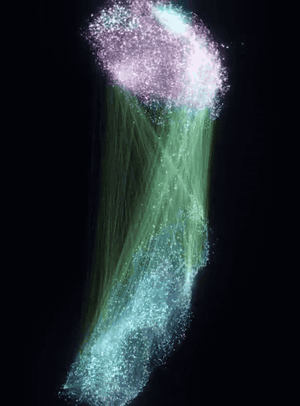
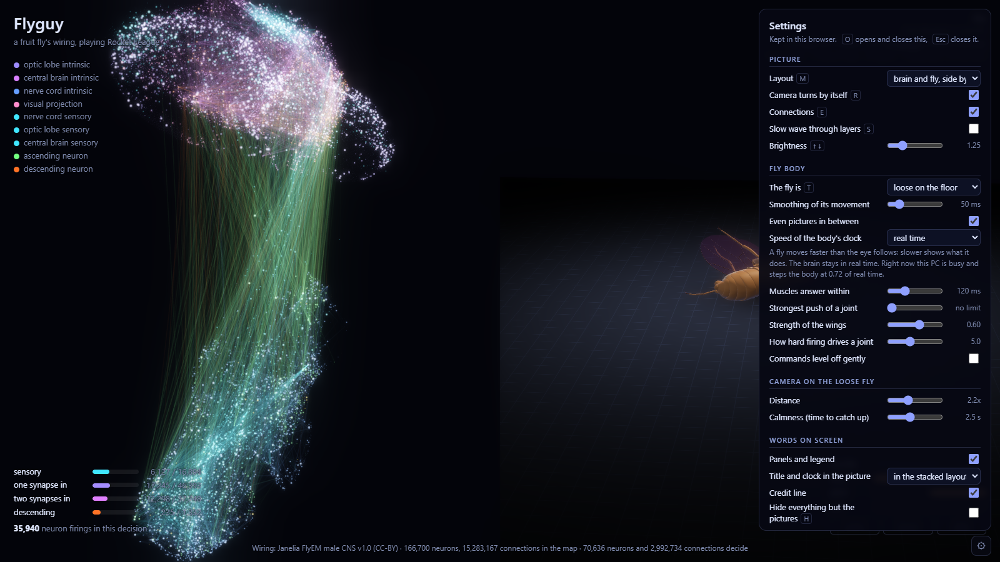

# The visualizer and the fly body

<p align="center"></p>

## The page

```
.venv\Scripts\python flyguy\viz\server.py                                                      a live game
.venv\Scripts\python flyguy\viz\server.py --demo flyguy\graphs\viz\demo_moments.bin bot\model.pt   no game needed
```

Open <http://localhost:8765>. The server is a few hundred lines of standard-library Python; the page is one HTML file
that draws with WebGL.

- **Live.** After every decision the bot writes the firing of every neuron in play, one byte each, into a small file
  in the temp folder (`flyguy_viz.bin`), with the action it chose. The server hands the newest frame to the page.
  Nothing waits for anything: start and stop the server whenever you like, the bot does not notice.
  `FLYGUY_VIZ=0` turns the bot's side off.
- **Demo.** flyguy decides on recorded game moments, 15 a second. The firing is real; there is just no game beside it.
- `--record FILE` keeps every frame, `--replay FILE` plays such a file back.

What you see: each point is a neuron, drawn where its cell body sits in the fly (brain on top, nerve cord below),
coloured by class. At each decision the firing moves through four layers: the sensory neurons, two hops of neurons in
between, and the descending neurons. Nothing is drawn that the network did not produce. With no game running the
picture is dark.

| key | |
|---|---|
| `O` | settings menu (everything below, and the fly body's settings) |
| `M` | layout: brain, brain and fly side by side, brain above fly, fly only |
| `E` | the strongest connections on or off |
| `S` | show the wave through the layers slowly |
| `R` | the camera turns by itself |
| `↑` `↓` | brightness |
| `H` | hide everything except the picture |
| `F` | full screen |
| `V` | record the picture (saved by the server under `runs/flyguy_viz/`) |
| `T`, `X` | the fly: pinned in the air or loose on the floor; put it back where it started |

**Videos.** Add `?view=stack&size=640x1080&autorec=1` to the address and the page records every match by itself, in a
tall format with the match clock in the picture. `flyguy/viz/compose.py GAME_VIDEO` then puts that recording to the
left of a 16:9 recording of the game and lines the two up (it needs `ffmpeg`). The picture at the top of the README
was made that way.

## The fly body

<p align="center"></p>

flyguy's answer is the firing of the fly's 1,332 descending neurons. In the connectome those connect straight to motor
neurons: 17,955 connections onto 782 of them, and Janelia's annotations name each motor neuron's muscle. The body
server

1. reads the descending neurons' firing from the same file the page reads,
2. carries it across those connections with the connectome's own starting strengths (they were never trained),
3. turns motor-neuron firing into commands for the matching joints (`flyguy/body/fly_map.py`: leg muscles by name,
   the wings' power and steering muscles, head and abdomen by body part),
4. steps the [flybody](https://github.com/TuragaLab/flybody) model in MuJoCo in real time, and serves the pose to the
   page.

The network was trained to play Rocket League. It was never trained to move a fly, and what the body does is not fly
behaviour.

### Setting it up

The body runs in its own environment (MuJoCo and flybody), kept apart from the bot's:

```
python -m venv .venv_body
.venv_body\Scripts\pip install mujoco numpy pillow
.venv_body\Scripts\pip install "git+https://github.com/TuragaLab/flybody.git@d015e9bfe441bd90ae431bac24c55cb74bdbce26"
```

That commit is the one this was made with (`flyguy/body/FLYBODY_COMMIT.txt`), with MuJoCo 3.15 on Python 3.12. On
Windows, `flyguy/viz/server.py` then starts the body by itself on the next port when it finds `.venv_body`. Elsewhere,
start it yourself: `python flyguy/body/body_server.py --port 8766`.

<p align="center"></p>

The settings menu (`O`) has the body's dials: how smooth the shown movement is, slow motion (a fly moves faster than
the eye follows), how fast and how strong the muscles are.

### Clips from a recorded game

```
set FLYGUY_RECORD=1                                    the bot writes what it saw to runs\flyguy_live\
.venv\Scripts\python flyguy\body\brain_to_motor.py runs\flyguy_live\live_X.bin bot\model.pt
.venv_body\Scripts\python flyguy\body\play_body.py runs\flyguy_body\live_X_motor.npz --mode tethered --out clip.mp4
```

## Rebuilding the data files

The files under `flyguy/graphs/viz/` are in the repository. To make them again you need Janelia's download and the
whole graph:

| file | made by | from |
|---|---|---|
| `layout.bin`, `meta.json` | `flyguy/viz/build_layout.py` | Janelia's annotation file (cell body positions) and the graph |
| `demo_moments.bin` | `flyguy/viz/make_demo.py` | a piece of training data (game moments as the bot sees them) |
| `motor_bridge.npz`, `motor_neurons.json` | `flyguy/body/build_motor_map.py` | Janelia's annotation file and the whole graph |
| `motor_weights.npz` | `flyguy/body/export_bridge.py` | a flyguy checkpoint of the whole graph |

Derived from the Janelia FlyEM Male CNS Connectome v1.0, CC BY 4.0. See [CREDITS.md](../CREDITS.md).
